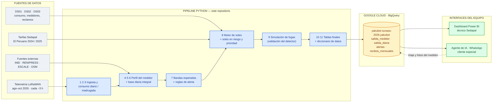
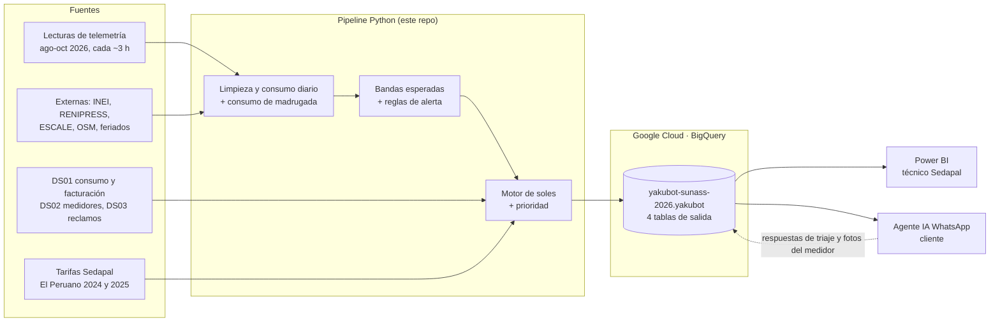
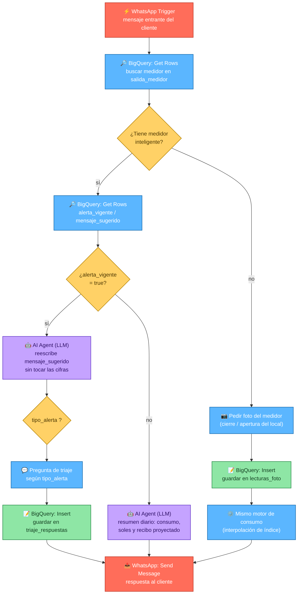

# YakuBot — Hackathon Sunass "Lideresas por el Agua" (Desafío 1: Gestión Comercial)

**Pregunta del reto:** ¿qué solución permite a los clientes especiales de Sedapal conocer su consumo diario, en volumen y en soles, y recibir alertas oportunas ante fugas o consumos anómalos?

**Nuestra respuesta:** un modelo que aprende el consumo normal de cada medidor, calcula su consumo diario en m³ y en soles con la tarifa oficial, detecta fugas, medidores detenidos y consumos atípicos, y deja todo en BigQuery. De ahí se alimentan dos interfaces:

- **Dashboard en Power BI** para el técnico de Sedapal: lista de casos por prioridad, mapa, soles en riesgo y medidores que dejaron de transmitir.
- **Agente de IA por WhatsApp** para el cliente: su consumo diario, el recibo proyectado y las alertas con la pregunta de triaje.

Este repositorio contiene la **parte estadística**: integración de datos, modelo, motor de soles, evaluación y carga a la nube.

---

## 1. Cómo fluye todo



Las fuentes alimentan el pipeline de este repositorio, el pipeline deja las 4 tablas finales en BigQuery, y de ahí se conectan en vivo el dashboard de Power BI y el agente de WhatsApp. El agente, a su vez, escribe de vuelta las respuestas de triaje y las lecturas por foto en sus propias tablas.

<details>
<summary>Ver el diagrama como código (Mermaid)</summary>


</details>

---

## 2. Dónde están los datos (Google Cloud)

| | |
|---|---|
| Proyecto | `yakubot-sunass-2026` |
| Dataset | `yakubot` (BigQuery, multirregión US) |
| Consola | [Abrir en BigQuery](https://console.cloud.google.com/bigquery?project=yakubot-sunass-2026&ws=!1m6!1m5!4m3!1syakubot-sunass-2026!2syakubot!3ssalida_diaria!23sTREE_NODE_SELECTION) |

> **Acceso restringido.** El enlace solo funciona para las cuentas autorizadas en el proyecto (propietaria e integrantes del equipo con permisos IAM). Cualquier otra persona verá "sin permiso". Para pedir acceso, escribir a la propietaria del proyecto.
>
> El proyecto está en el modo gratuito de BigQuery (zona de pruebas): las tablas vencen a los 60 días. Para renovarlas basta con volver a correr la carga (sección 9).

Permisos del equipo: **Editor de datos de BigQuery** sobre el dataset (leer las tablas y crear las propias) y **Usuario de trabajos de BigQuery** sobre el proyecto (ejecutar consultas).

---

## 3. De dónde salen los datos

### Datos del reto (entregados por Sunass)

| Archivo | Qué trae | Cómo lo usamos |
|---|---|---|
| `Lecturas de medidores.xlsx` (hojas agosto, setiembre, octubre) | 768,764 lecturas del índice acumulado (m³ enteros) de 1,611 medidores ultrasónicos LoRaWAN, cada ~3 horas | **Base del modelo:** de aquí sale el consumo diario y el de madrugada |
| `Lecturas de medidores.xlsx` (hoja `BD_ESCE`) | 1,703 medidores registrados con coordenadas y fecha de registro | Ubicación (mapa, distrito) y cruce con fuentes externas |
| `DS01.xlsx` | 20 suministros: consumo e importes mensuales de 2025 y 2026, con código de tarifa (T02 a T05) | **Validación del motor de soles** (379 de 380 meses cuadran) |
| `DS02.xlsx` | Ficha de esos mismos 20 medidores (todos AMR LoRaWAN) | Confirmar el cruce con DS01 (20 de 20) |
| `DS03.xlsx` | 283 reclamos de 107 suministros (2021 a 2026); 184 son por "consumo medido" | Contexto del problema y validación por distrito. **No entra al modelo:** solo 1 suministro cruza con DS01 |
| Estructura tarifaria (PDF) | Tarifa vigente desde febrero de 2026 y ejemplos de recibo | Motor de soles (`config/`) |

> Los medidores de DS01/DS02 (`MED-…`) **no aparecen** en las lecturas de telemetría (`00KA…`/`00KB…`). Por eso la categoría tarifaria de los 1,608 medidores con lecturas no se conoce y se asume (sección 8).

### Fuentes externas (públicas)

| Fuente | Entidad | Acceso | Aporta |
|---|---|---|---|
| Estructura tarifaria 2025 | Sedapal, El Peruano 31.12.2024 | `config/` | Validar los importes 2025 de DS01 |
| Límites distritales | INEI vía GEO Perú (repo `juaneladio/peru-geojson`) | Automático | Distrito de cada medidor |
| RENIPRESS | SUSALUD, Plataforma Nacional de Datos Abiertos | Automático (CSV mensual) | Hospitales, clínicas con internamiento y hemodiálisis cercanos: 405 de 5,703 establecimientos activos en Lima y Callao |
| Padrón de instituciones educativas (ESCALE) | MINEDU | Manual (la web bloquea robots) | 9,383 locales escolares activos, con nivel, gestión y turno |
| OpenStreetMap | Comunidad OSM, API Overpass | Automático (opcional) | Hoteles, mercados, lavanderías, oficinas de gobierno |
| Feriados y calendario escolar 2026 | `holidays` (Perú) y MINEDU | En código | Tipo de día y vacaciones escolares |

**Privacidad (Ley 29733):** el perfil del cliente se infiere por cercanía (≤ 60 m) a un establecimiento. Del establecimiento solo se guarda el tipo y la distancia, nunca el nombre ni la dirección, para no reidentificar al cliente.

---

## 4. Cómo funciona el pipeline

| Paso | Script | Qué hace | Resultado |
|---|---|---|---|
| 1 | `src/ingest/punto.py` | Une DS01, DS02 y DS03 por suministro | Maestro de 20 suministros |
| 2 | `src/ingest/lecturas.py` | Junta las 3 hojas de lecturas en formato largo | 768,764 lecturas |
| 3 | `src/features/run_consumo.py` | Descarta lecturas que bajan (errores de transmisión: 5,013, el 0.65 %), interpola el índice a medianoche y saca el consumo diario | 136,054 días de 1,608 medidores |
| 4 | `src/external/*.py` | Coordenadas, distrito, cercanía a colegios y salud, perfil y criticidad | Perfil de cada medidor |
| 5 | `src/external/integrar.py` | Une consumo, calendario y perfil | Base diaria integral |
| 6 | `src/features/nocturno.py` | Consumo de 0 a 5 am de cada día (solo si hay lecturas reales a menos de 4 h de cada corte) | Consumo de madrugada |
| 7 | `src/model/detectar.py` | Aprende las bandas (agosto y setiembre) y diagnostica octubre | Diagnóstico diario y alertas |
| 8 | `src/model/soles.py` | Valida la tarifa contra DS01, calcula recibos y soles en riesgo | Recibos y prioridad |
| 9 | `src/simulate/fugas.py` | Inyecta fugas artificiales y mide la detección | Desempeño del modelo |
| 10 | `src/model/salida.py` | Arma las tablas finales y el mensaje para WhatsApp | `salida_medidor`, `salida_diaria` |
| 11 | `scripts/diccionario.py` | Genera el diccionario de datos | `docs/diccionario_datos.xlsx` |
| 12 | `scripts/subir_bigquery.py` | Sube las 4 tablas a BigQuery | Tablas en la nube |

El paso de medidores a tablas va así: 1,822 con telemetría según el expediente → 1,703 registrados en `BD_ESCE` → 1,611 con lecturas → **1,608 con consumo calculado** → 1,530 con banda (≥ 10 días de historial) → 1,513 evaluados en octubre.

---

## 5. El modelo

**Idea central:** cada medidor se compara **consigo mismo**. Un hospital que consume de noche y un colegio cerrado con fuga se ven distintos porque cada uno tiene su propia "banda" de consumo normal.

1. **Consumo diario.** El índice del medidor es acumulado; el consumo del día es la diferencia entre medianoches, con el índice interpolado entre lecturas reales. Funciona igual con una lectura cada 3 horas o con una al día (probado: error mediano de 0.2 % semanal con una sola lectura diaria). Por eso el mismo motor sirve para clientes sin medidor inteligente que manden fotos.
2. **Consumo de madrugada (0 a 5 am).** Es la señal más clara de fuga: si nadie usa agua y el medidor avanza, se está perdiendo.
3. **Banda esperada.** Para cada medidor y tipo de día (laborable, sábado, domingo o feriado) se calculan los percentiles P10, P50 y P90 de su historial. El día se marca fuera de banda si supera P90 más un margen (mínimo 1 m³, por la resolución del medidor; más ancho cuando hay pocos días de ese tipo). En colegios no se usan los días de vacaciones escolares para aprender la banda.
4. **Reglas de alerta:**

| Alerta | Regla | Qué suele significar |
|---|---|---|
| `fuga_continua` | La madrugada supera su propio P90 + 0.5 m³ en 6 de las últimas 7 noches | Fuga interna después del medidor |
| `medidor_detenido` | 7 días seguidos en 0 m³ cuando en una semana normal consumiría ≥ 5 m³ | Medidor parado o manipulado: agua que no se factura |
| `consumo_atipico` | 3 días seguidos sobre su límite, o un día al triple del límite | Cambio de uso o fuga que empieza |

   El 22 % de los medidores ya consume de madrugada al mismo ritmo que de día (cisternas que llenan de noche, operación 24 h). Por eso **no** alertamos por "consumo plano": solo cuando la madrugada **sube** respecto a su propio historial.

5. **Motor de soles.** Aplica la estructura tarifaria oficial: tramos escalonados por categoría, cargo fijo, agua, alcantarillado e IGV 18 %, y Grupo 1 o 2 según el distrito. Las tarifas se leen de `config/` (editables en Excel) con su vigencia, así que una tarifa nueva se agrega sin tocar el código.
6. **Soles en riesgo y prioridad.**
   - Soles en riesgo = cuánto más se pagaría (o dejaría de facturarse) por cada mes que el problema siga, respetando tramos e IGV.
   - `prioridad` = peso del tipo (fuga 3, detenido 2, atípico 1) × criticidad del cliente (salud y colegios 3; gobierno, hoteles y mercados 2; resto 1) × ln(1 + soles en riesgo). El logaritmo evita que la plata aplaste a lo demás: un comercio grande no le gana a la fuga de un colegio solo por su tamaño.
   - `ranking_prioridad` = puesto en la lista de atención (1 = más urgente).

---

## 6. Desempeño

### Detección (simulación con fugas inyectadas)

Se tomaron los 1,259 medidores sin ninguna alerta en octubre. A cada uno se le inyectó una fuga de caudal constante, desde un momento al azar entre el 6 y el 18 de octubre, directo en sus lecturas y redondeada a m³ enteros como el medidor real. Luego se corrió el mismo detector.

| Escenario | m³/día | Detectado | Días hasta la alerta (mediana) | Días (p90) |
|---|---|---|---|---|
| Fuga 0.05 m³/h | 1.2 | 10 % | 8 | 18 |
| Fuga 0.1 m³/h | 2.4 | 40 % | 3 | 11 |
| Fuga 0.25 m³/h | 6 | 72 % | 2 | 6 |
| **Fuga 0.5 m³/h** | **12** | **90 %** | **2** | 6 |
| Fuga 1 m³/h | 24 | 97 % | 1 | 3 |
| Medidor detenido (consume ≥ 1 m³/día) | — | 99 % | 7 | 7 |

Lo que más pesa es **el tamaño de la fuga frente al consumo normal del cliente**: se detecta en el 11 % de los casos si es menos del 25 % de su consumo, en el 32 % entre 25 y 50 %, en el 58 % entre 50 y 100 %, y en el **88 %** si es mayor que su consumo normal.

**En una frase:** una fuga de 0.5 m³/h (unos 360 m³ al mes) se detecta en el 90 % de los casos en 2 días. Hoy se descubre en el recibo, un mes después.

### Motor de soles

- Los 3 ejemplos oficiales del recibo (10, 15 y 25 m³ doméstico) dan exactamente S/ 49.68, 72.33 y 125.67.
- Contra los importes reales de DS01, **379 de 380 meses cuadran** (99.7 %, ±S/ 0.05) en 2025 y 2026, en todas las categorías.

### Datos reales (octubre de 2026)

- 5.5 % de los días quedan fuera de banda.
- 248 alertas en el mes (16 % de los medidores evaluados tuvo alguna).
- **72 alertas vigentes al cierre** (5 % de los medidores): 12 fugas continuas, 37 medidores detenidos y 23 consumos atípicos, por unos **S/ 441 mil al mes** en riesgo.

> **Lo que no se puede medir:** no hay casos confirmados de fuga en los datos, así que la tasa de falsas alarmas es desconocida. Las fugas de la simulación son artificiales y se rotulan como tales.

---

## 7. Salidas: las 4 tablas

Todas están en `yakubot-sunass-2026.yakubot` y, en local, en `data/processed/`. Cada columna está explicada en **`docs/diccionario_datos.xlsx`**, que además trae una hoja sobre qué predice el modelo y qué tan bien detecta.

| Tabla | Una fila por | Columnas clave | La usa |
|---|---|---|---|
| `salida_medidor` | Medidor (1,608) | `consumo_m3`, `banda_p50_m3`, `consumo_mes_acum_m3`, `soles_mes_acum`, `recibo_proyectado_soles`, `alerta_vigente`, `tipo_alerta`, `soles_riesgo_mes`, `prioridad`, `ranking_prioridad`, `lat`, `lon`, `dias_sin_datos`, `mensaje_sugerido` | Agente (situación de cada cliente) y Power BI (lista de trabajo y mapa) |
| `salida_diaria` | Medidor y día (136,054) | `consumo_m3`, `banda_p10_m3` / `p50` / `p90`, `limite_alerta_m3`, `consumo_noche_m3`, `noche_normal_m3`, `estado`, `soles_dia`, `recibo_proyectado_soles` | Power BI (gráfico de consumo contra banda) y agente ("muéstrame mi mes") |
| `alertas` | Alerta (248) | `tipo_alerta`, `vigente`, `primera_alerta`, `dias_en_alerta`, `exceso_m3_dia`, `soles_riesgo_mes`, `prioridad` | Power BI (historial de casos) |
| `recibos_mensuales` | Medidor y mes (4,592) | `m3`, `agua`, `saneamiento`, `cargo_fijo`, `igv`, `total` | Agente ("¿por qué salió alto mi recibo?") y Power BI |

---

## 8. Cómo se conectan las interfaces

### Power BI (dashboard del técnico de Sedapal)

En Power BI Desktop: **Obtener datos → Google BigQuery → iniciar sesión con una cuenta autorizada → `yakubot-sunass-2026` → `yakubot`** → seleccionar las tablas. Contenido sugerido:

| Sección | Tabla y columnas |
|---|---|
| Indicadores: alertas vigentes por tipo, soles en riesgo, medidores detenidos, medidores sin transmitir | `salida_medidor`: `alerta_vigente`, `tipo_alerta`, `soles_riesgo_mes`, `dias_sin_datos` |
| Lista de trabajo por urgencia | `salida_medidor` donde `alerta_vigente`, ordenada por `ranking_prioridad` |
| Mapa de casos | `lat`, `lon`, color por `tipo_alerta`, tamaño por `prioridad` |
| Ficha del medidor: consumo contra banda, madrugada, historial y recibos | `salida_diaria`, `alertas`, `recibos_mensuales` |
| Telemetría caída | `salida_medidor` donde `dias_sin_datos > 1` |

### Agente de IA por WhatsApp (cliente)

El agente corre como un flujo de **n8n** conectado a BigQuery y a un modelo de lenguaje. Así queda el workflow:



1. **Identifica al cliente:** el disparador de WhatsApp recibe el mensaje y busca el número en `salida_medidor`; si aparece, tiene medidor inteligente.
2. **Con medidor inteligente:**
   - Resumen diario: consumo de ayer en m³ y soles frente a lo normal, lo que lleva del mes y el recibo proyectado.
   - Alerta con `mensaje_sugerido`, que ya trae las cifras calculadas. El nodo de IA (LLM) lo reescribe en lenguaje natural sin cambiar los números.
   - Pregunta de triaje según `tipo_alerta` (fuga: "cierra las llaves, ¿el medidor sigue girando?"). La respuesta se guarda en la tabla propia del agente `triaje_respuestas`.
3. **Sin medidor inteligente:** el cliente manda fotos del medidor (cierre y apertura del local). Con dos o más lecturas el mismo motor de consumo (interpolación de índice) calcula su consumo y su recibo proyectado, y con la foto de cierre/apertura hace la prueba de fuga. Las lecturas quedan en `lecturas_foto` (`medidor, fecha_hora, lectura_m3, fuente`).

> **Regla del equipo:** el agente y el dashboard escriben solo en sus tablas propias (`triaje_respuestas`, `lecturas_foto`). Las 4 tablas de salida de este repositorio se **reemplazan completas** cada vez que se actualiza el modelo.

---

## 9. Cómo correrlo

### Instalación
```bash
pip install -r requirements.txt
cp .env.example .env        # y completar GCP_PROJECT, BQ_DATASET, BQ_LOCATION
```
Los datos del reto van en `01 GESTIÓN COMERCIAL INFORMACION/` y el padrón de ESCALE en `data/external/Padron_web_AAAAMMDD/`. **No se suben al repo** (ver `.gitignore`).

### Todo con un comando (~2 minutos)
```bash
python scripts/correr_todo.py                    # todo, en orden
python scripts/correr_todo.py --desde detectar   # desde un paso
python scripts/correr_todo.py --sin-simulacion
```
Si una fuente externa opcional falla (RENIPRESS, OSM o ESCALE), avisa y el resto sigue. La fecha de corte entre entrenamiento y diagnóstico está en `src/config.py`.

### Subir a BigQuery
Una sola vez: instalar Google Cloud CLI y ejecutar `gcloud auth application-default login`. Luego:
```bash
unset GOOGLE_APPLICATION_CREDENTIALS   # si la PC tiene credenciales de otro proyecto
python scripts/subir_bigquery.py
```

---

## 10. Supuestos y limitaciones

- **Categoría tarifaria supuesta.** Las lecturas de telemetría no traen la tarifa. Asumimos colegio o salud públicos = estatal y el resto = comercial (1,407 comerciales y 201 estatales). El expediente indica 58 % comerciales y 36 % estatales, así que hay entidades estatales sin identificar, y los soles de esos casos salen algo altos. Con la tabla real `medidor → tarifa` de Sedapal se reemplaza sin cambiar el código.
- **Perfil inferido.** "Colegio" o "salud" sale de la cercanía a un establecimiento (≤ 60 m), no de un dato confirmado. Validación indirecta: en los días laborables de vacaciones escolares, el consumo de los medidores marcados como colegio baja 12 %, el de salud no baja, y el del resto apenas 3 %.
- **Historial corto.** Las bandas se aprenden con dos meses (agosto y setiembre). Con más meses, incluida la estacionalidad del verano, serán más estables y habrá menos alertas: con un solo mes de historial alerta el 27 % de los medidores; con dos, el 16 %.
- **Resolución.** Las lecturas llegan cada ~3 horas y en m³ enteros. No se presenta consumo hora por hora, y las fugas pequeñas frente al consumo del cliente casi no se distinguen.
- **Falsas alarmas.** Sin casos confirmados no se pueden medir. El triaje por WhatsApp sirve justamente para etiquetarlas y, en adelante, recalibrar las reglas.

## Hallazgos para Sedapal

- **72 casos vigentes** al 30 de octubre, por unos **S/ 441 mil al mes**. El primero es un colegio en Los Olivos que pasó de unos 14 a 88 m³ por día a mediados de octubre, con la madrugada subiendo de 3 a 20 m³.
- **37 medidores detenidos**: agua que hoy no se registra ni se factura.
- **136 medidores inteligentes no reportan**: 92 sin ninguna lectura en tres meses y 44 sin transmitir hace más de una semana. Nadie lo nota hoy.

---

## Estructura del repositorio

```
config/      tarifas (CSV editables en Excel)
docs/        diccionario_datos.xlsx
scripts/     correr_todo.py, subir_bigquery.py, diccionario.py
src/
  ingest/    lectura de los Excel del reto
  external/  fuentes externas, perfil e integración
  features/  calendario, limpieza, consumo diario y de madrugada
  model/     bandas, detección, soles, tablas de salida
  simulate/  simulación de fugas
  config.py  fecha de corte del modelo
data/        (no se sube) crudos, externos y procesados
```
